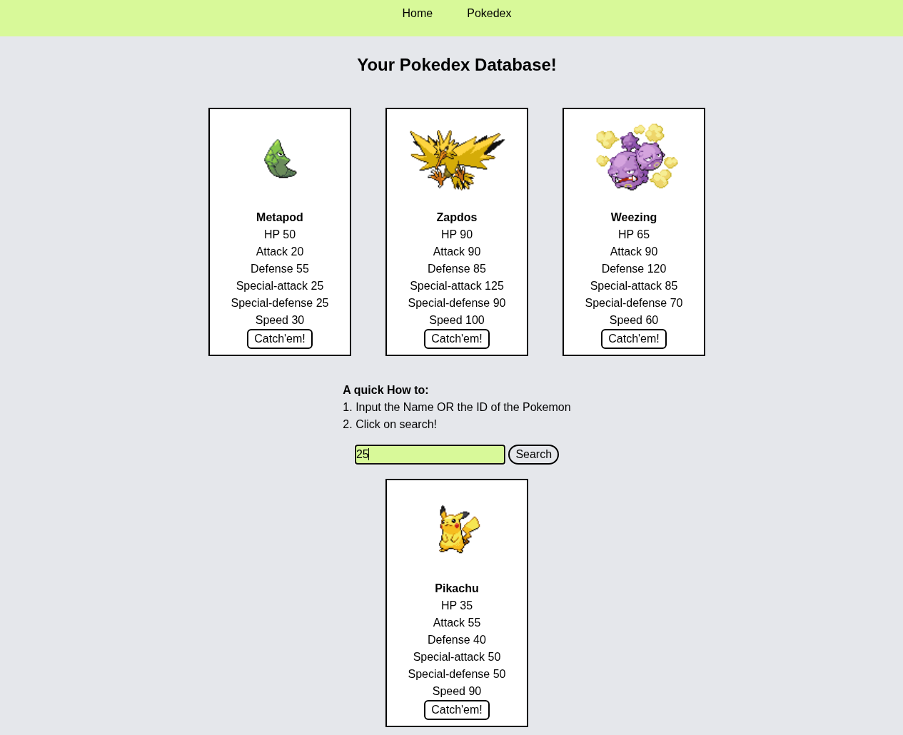
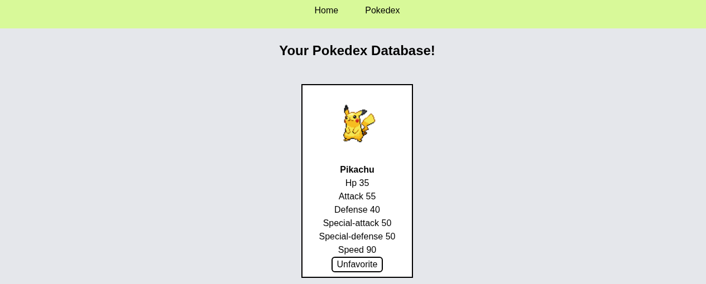

# Pokédex

A two-page Pokédex built with vanilla JavaScript — no framework, no build step, no
dependencies beyond a Tailwind CDN. Search the PokéAPI by name or numeric ID, catch the
Pokémon you want, and keep your own collection with personal notes.

## What it does

**Home** loads three random Generation I Pokémon and gives you a search box that accepts
either a name (`charizard`) or an ID (`6`). Results appear as cards with the sprite, name,
and all six base stats. Enter and the Search button both work.

**Pokédex** lists everything you've caught. Each card has an Unfavorite button that
releases the Pokémon and removes it from your collection.

## Running it

No install and no tooling — clone the repo and open`index.html` in a browser. That's it.

An internet connection is required: sprites and data come from the PokéAPI, and Tailwind
loads from a CDN.

## How it works

The app is deliberately framework-free, which kept the interesting problems visible instead
of hiding them behind abstractions.

**Talking to the API.** Data comes from a single PokéAPI endpoint that accepts either a
name or a numeric ID. The important detail is that a failed lookup has to be caught
explicitly a browser's fetch only reports network failures, not "this Pokémon doesn't
exist". Without handling that case, a typo would show an empty card with no explanation,
so a misspelled search now surfaces a clear error instead.

**Building cards in JavaScript.** Each card is assembled element by element rather than
written as HTML. Doing it that way makes the ordering explicit — the sprite goes above the
stats, and the newest search result is placed at the top of the list so it's immediately
visible.

**Saving your collection.** Caught Pokémon are stored in the browser's local storage as
data, which is what lets them survive a page reload and appear on the second page.